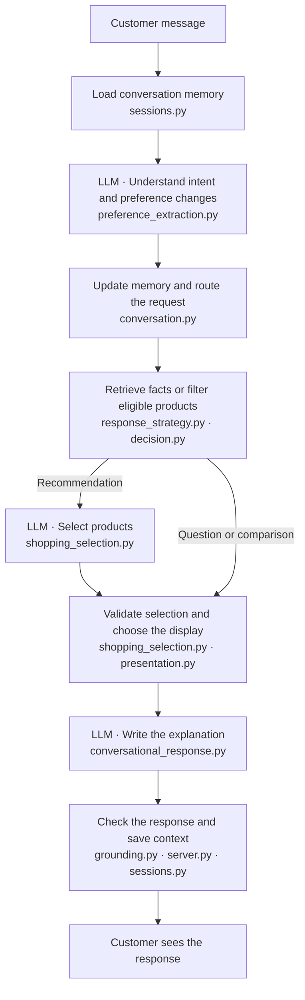
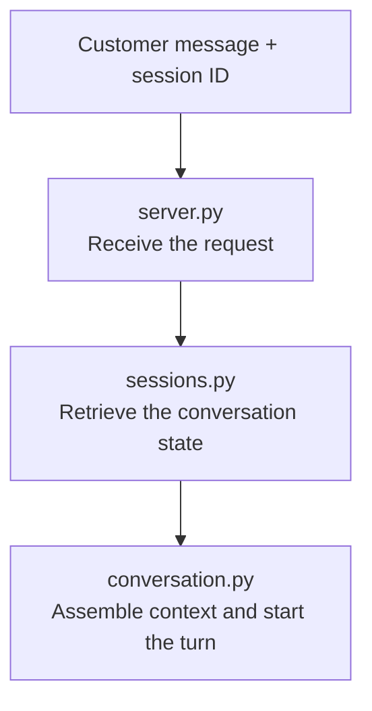
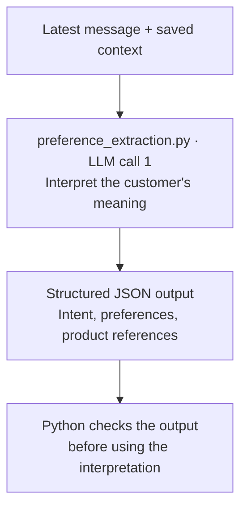
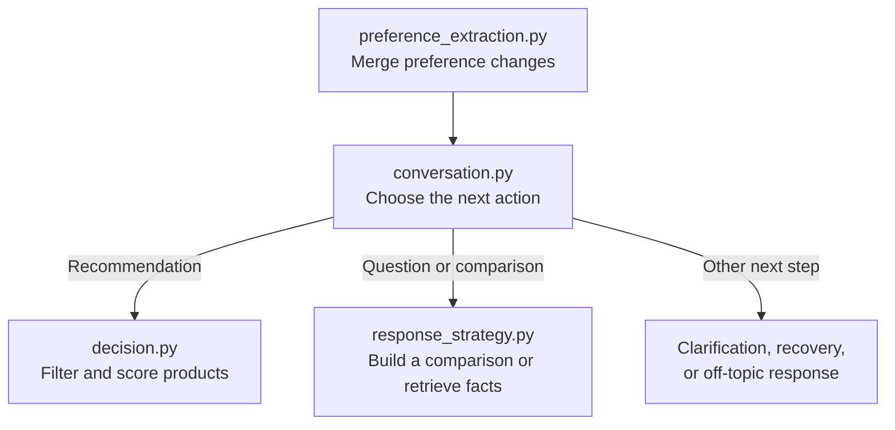
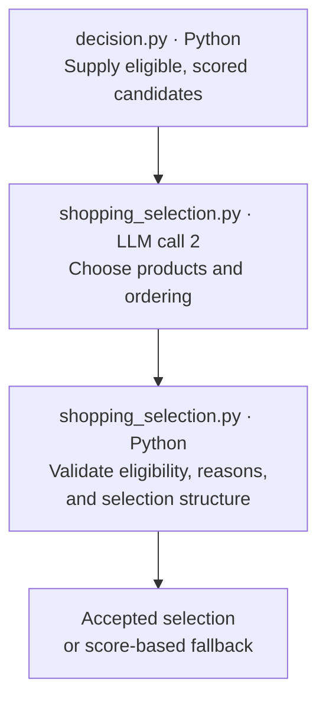
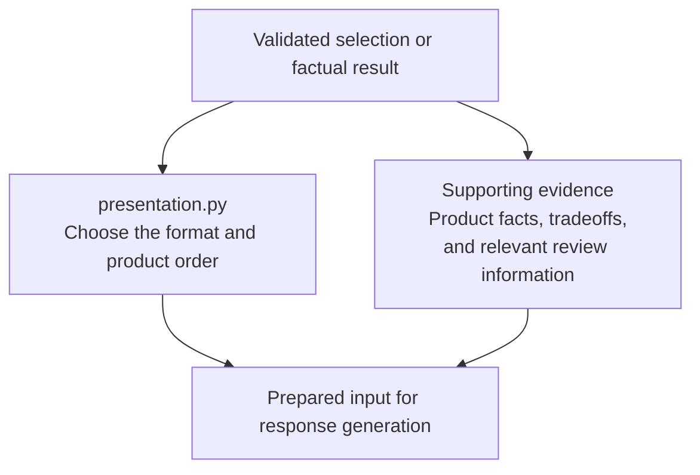
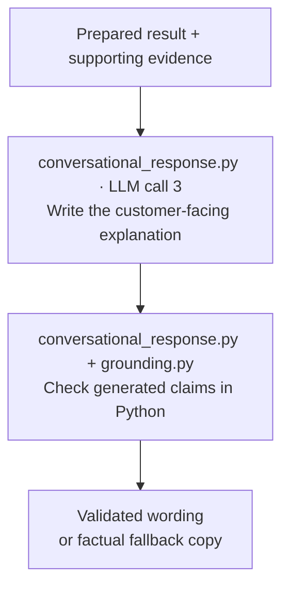
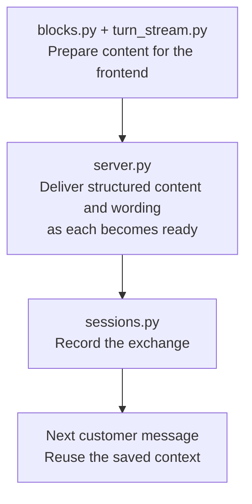

# Shopping Agent Flow

A companion to [How the Shopping Agent Works](ARCHITECTURE.md).

Python coordinates the conversation, maintains memory, and enforces product rules. The LLM is called for specific jobs: understanding the customer, selecting products, and writing the explanation.

## From customer message to response

All filenames below are Python files. **LLM** identifies a step that calls a language model. The other steps run application code.

## Application controlled orchestration

**Orchestration** means coordinating the steps that turn a customer message into a useful response. In this agent, Python owns that coordination. The application calls the LLM for defined jobs, checks what comes back, and determines what runs next.

A typical successful recommendation turn makes three separate LLM calls:

1. **Interpret the message:** identify intent, preference changes, and product references.
2. **Select products:** choose among candidates that passed the application's eligibility rules.
3. **Write the explanation:** express the result using the supplied evidence.

These are separate requests, not necessarily different models. A product question or comparison usually skips product selection and makes two calls.

The overall diagram shows the main Live-mode path. The sections below unpack it. Demo mode uses scripted browser behavior instead. The catalog and review evidence are synthetic fixtures, even in Live mode.

## 1. The application receives the message and loads memory

**Owner: Python. No LLM call at this step.**

The frontend sends the message with its conversation session ID. `api/server.py` finds the matching session, retrieves its context, and starts the turn. `api/sessions.py` holds the memory. `engine/conversation.py` coordinates the engine work through `process_conversation_turn()`.

The session includes the accumulated preference object, recent conversation, previous decision, product presentation records, and any outstanding question or recovery proposal. The model is supplied with this context; it does not independently remember the session.

For example, if the customer previously requested a queen around $1,500 with strong cooling, those preferences are available when they say “Actually, make it a king.”

## 2. LLM call one interprets the message

**Owner: the LLM interprets; Python defines the output format and validates it.**

`engine/preference_extraction.py` runs `extract_preference_update()`. Despite the filename, this call performs several language-understanding jobs together:

- **Intent classification:** identify whether the customer wants recommendations, a comparison, a product or service answer, or something off-topic.
- **Preference extraction:** identify changes to size, budget, requirements, desired attributes, or priorities.
- **Reference resolution:** connect “the second one” or “that mattress” to the products shown.
- **Clarification assessment:** identify ambiguity that prevents a useful next step.

The actual model request is `client.responses.create(...)` inside `extract_preference_update()`. Instructions come from `prompts/preference_extraction.md`; the output must follow a defined JSON schema.

For “Actually, make it a king,” the relevant preference change is `size: king`. The interpretation can also identify this as a recommendation refinement. Python checks the output structure and product references, but those checks cannot guarantee that every interpretation is correct.

A recognized answer to a structured clarification option can bypass this call: application code already knows what the selected option means.

## 3. Python updates memory and decides what to run

**Owner: Python, using the model's interpretation.**

`merge_preference_state()` in `engine/preference_extraction.py` applies the update to the saved profile. New values replace the corresponding old values; unchanged preferences remain. In preference updates, `null` means “no change,” so it does not erase an existing value.

`engine/conversation.py` then performs **dialogue management**: using the intent and current state to decide the next action. The model influences this through its interpreted action, but Python defines the supported paths and their rules.

For recommendations, `engine/decision.py` checks hard requirements such as size, an absolute price ceiling, and latex exclusion. It scores eligible products using represented attributes and shopper preferences. **Filtering and scoring do not call an LLM.**

For questions and comparisons, `engine/response_strategy.py` assembles the relevant product, service, or review information. `engine/data.py` supplies the catalog, and `engine/review_data.py` supplies review evidence. These are local synthetic data sources, not a live retailer search.

Two supporting files handle special paths: `engine/elicitation.py` builds and resolves structured clarification options, while `engine/recovery.py` constructs supported ways forward when requirements conflict or no products qualify. Neither makes model calls.

## 4. LLM call two selects products when needed

**Owner: Python determines eligibility; the LLM chooses among eligible candidates.**

`engine/shopping_selection.py` runs `select_shopping_products()`. The model receives eligible products, shopper preferences, recent context, calculated score signals, tradeoffs, and relevant review evidence when available.

Its job is to choose useful products and their order. It can propose a primary recommendation when the available evidence supports one, or an exploratory shortlist when a single winner would be premature.

The request is another `client.responses.create(...)`, this time inside `select_shopping_products()`, with a structured product-selection schema and instructions from `prompts/shopping_selection.md`.

This is where the LLM can exercise shopping judgment. The highest-scoring products may be very similar; the model can choose a more useful set of alternatives within the eligible pool.

Python checks the returned selection. If it fails, the code permits one retry and then falls back to the calculated product order. A routine factual question or comparison does not need this selection call.

## 5. Python chooses the presentation and grounds the response

**Owner: Python. No LLM call at this step.**

`engine/presentation.py` runs `build_turn_presentation()` to choose the format: recommendation cards, a comparison table, product detail, recovery choices, or conversation. The product identities and order are fixed in the presentation before final prose is accepted.

**Grounding** means supplying the facts and decision results that support the answer. `engine/grounding.py` builds recommendation evidence; factual and comparison paths carry the evidence assembled by `response_strategy.py`.

These are related application responsibilities, not a rigid ordering of every helper function. Together they determine what the customer will see and what the generated explanation can support.

## 6. LLM call three writes the explanation

**Owner: the LLM writes; Python checks and accepts the wording.**

`engine/conversational_response.py` runs `generate_turn_response()`. It receives the current message, recent conversation, shopper state, selected presentation, decision results, and relevant evidence.

The network request is made by `_model_output()` in `conversational_response.py`, normally through `client.responses.create(...)`. A Chat Completions compatibility path also exists. Response instructions are loaded from the files under `prompts/`, including `conversational_turn.md` and the relevant retry or off-topic instructions.

The model explains the prepared result. Python checks for supported product references, represented facts, and other constraints. These are code-based checks, not an additional LLM judge. Failed validation can trigger one rewrite; if the response still fails, the application uses fallback copy. The checks reduce unsupported claims but do not prove every possible statement is correct.

“Call three” describes its place in a recommendation turn. For a factual question that skips product selection, response generation is usually the second model call.

## 7. Python delivers the response and retains context

**Owner: Python. No additional LLM call for delivery or storage.**

`api/blocks.py` converts the engine presentation into blocks the frontend can render. `api/turn_stream.py` helps separate structured content from explanatory text. `api/server.py` delivers the result and records the completed exchange in the session.

Validated cards or a comparison can appear before the explanation finishes. The application does not need to wait for all prose to display the structured result.

Memory updates happen throughout the turn: preferences are saved before final prose generation, presentation records capture product identities and order, and messages are recorded as the turn completes. The overall diagram groups these responsibilities for readability.

This memory is session-based. Recent model context uses the last eight messages and up to four recent presentation records, while supported preferences accumulate separately. The Live API stores sessions in server memory, with a four-hour inactivity limit and capacity for 64 sessions. Server restarts erase them; there is no persistent customer-profile database.

## Model calls at a glance

Typical successful paths, excluding retries:

| Customer interaction | Interpret message | Select products | Write response | Total calls |
|---|---|---|---|---|
| Get or refine recommendations | 1 | 1 | 1 | 3 |
| Ask a product question | 1 | 0 | 1 | 2 |
| Compare products | 1 | 0 | 1 | 2 |
| Send an off-topic message | 1 | 0 | 1 | 2 |

Recognized structured answers can bypass interpretation, failure paths can use fixed copy, and retries can increase the count. These are common paths, not a fixed call budget for every turn.

`engine/model_config.py` chooses model settings for each task without calling a model to make that choice. Separate calls can use the same underlying model, with task-specific instructions and reasoning settings. They are not independent agents with separate goals or memories.

## How this differs from an LLM tool calling loop

In an LLM-directed tool loop, the model requests a tool, receives its result, and decides which tool to request next. In this application's main Live path, Python invokes functions and model calls according to explicit routing and rules. The inspected model requests do not register tools for the model to execute.

The LLM still influences behavior: its interpretation can lead to a comparison, and its selection determines which eligible products are proposed. Python bounds those choices, validates outputs, and controls continuation. The retry loops are limited to particular stages rather than open-ended planning.

The repository also contains `engine/baseline_llm.py` and `engine/explanation_llm.py`, which make model calls for older baseline/debug paths. They are not additional stages in the integrated Live API flow above.

## Where to go deeper

- [Architecture guide](ARCHITECTURE.md): product behavior, rules, grounding, and prototype boundaries.
- [API server](../api/server.py): request handling, generation, delivery, and session updates.
- [Conversation coordinator](../engine/conversation.py): routing and the main engine flow.
- [Model configuration](../engine/model_config.py): task-specific model settings.

Files named in the diagrams are under `api/` or `engine/` within `Grounded-Shopping-AI`.
