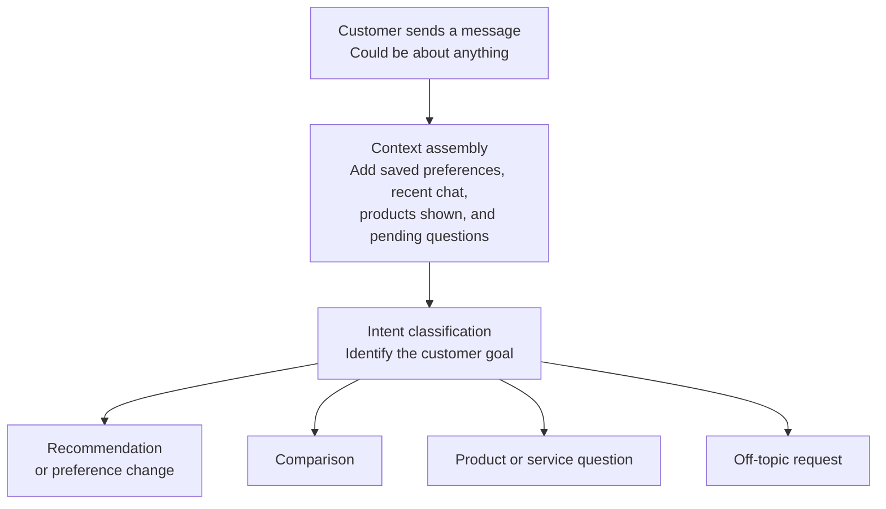
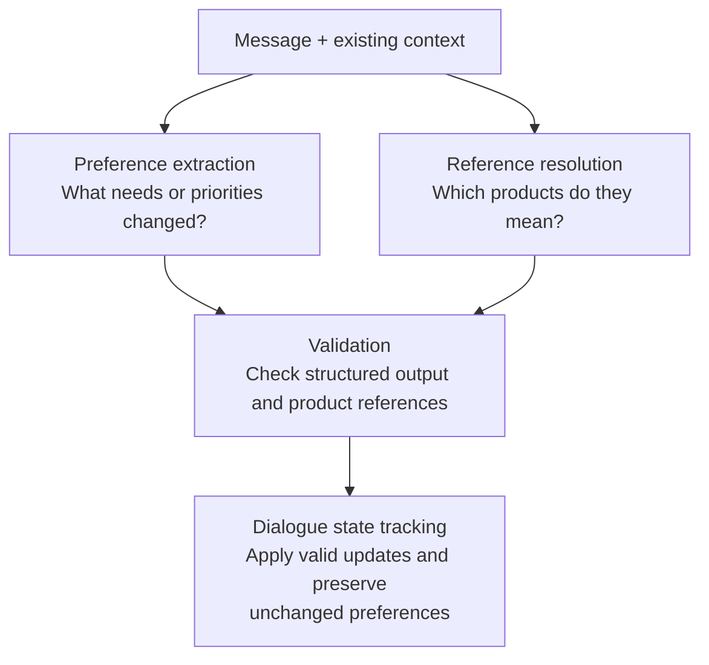
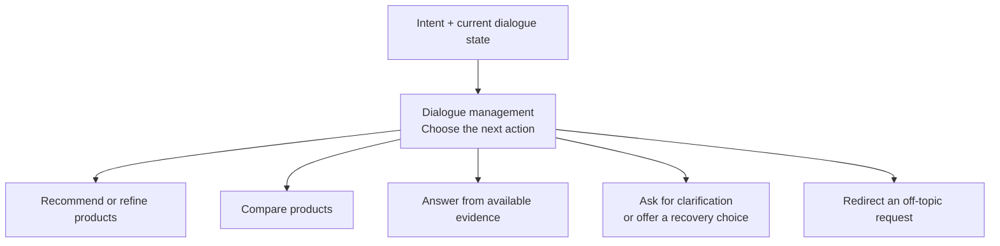
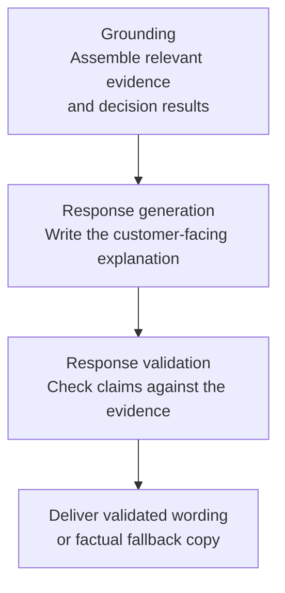
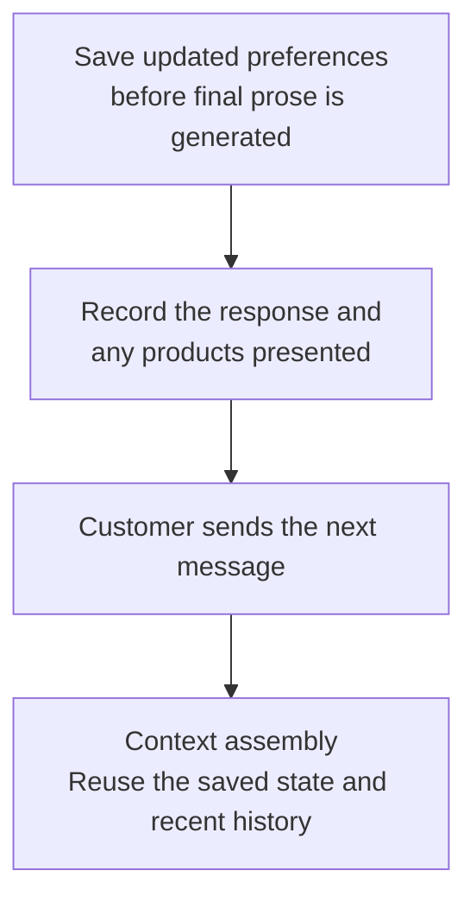

# How the Shopping Agent Works

The shopping agent combines AI language understanding with application-managed memory, product selection rules, and evidence checks. This guide explains that flow for product managers, designers, and anyone curious about the experience. No programming background is required.

Start with the small diagrams in [the conversation flow](#what-happens-after-a-shopper-sends-a-message). Each introduces a standard industry term and explains it in everyday language. The later sections cover recommendation decisions, response delivery, and prototype limits. For installation, see the [technical overview](TECHNICAL_OVERVIEW.md).

For the overall flow and how each step maps to Python files and model calls, see the [Shopping Agent Flow companion](AGENT-FLOW.md).

## The product in one sentence

The prototype is a mattress shopping assistant that can understand natural conversation, remember a shopper's needs during the session, show safe and useful options, compare products, and answer product, service, or review questions using only information represented in this repository.

It is a prototype, not a live store. The 48 mattresses, prices, service details, and customer-review summaries are synthetic local fixtures. There is no checkout, live inventory, retailer connection, or customer account.

## Where the shopper sees this

The shopper interface is a mobile shopping-assistant surface with two modes that share one visual system:

- **Demo** replays a scripted, fixture-backed conversation entirely in the browser. It needs no backend and is the reliable presentation path.
- **Live** sends each turn to the engine described below. It makes actual model calls and computes responses against the synthetic catalog and review fixtures. It does not access a live store.

Switching modes clears the conversation. The two never share state.

One detail is worth stating plainly because it affects how the cards should be read. The engine is authoritative for everything commercial: which products are selected, in what order, at what price, under which constraints, and why. The interface adds a small fixture layer of decorative shopping chrome — product photography, a display rating, a review count, a Prime badge, a delivery date — because the engine's catalog holds none of those and a card without them would look broken. Those decorative values never reach the engine and never influence what it recommends.

## The central design principle

The experience combines two kinds of decision-making:

- The shopping agent interprets the shopper, makes bounded judgments, chooses useful products from a safe set, and writes natural responses.
- Trusted application rules decide what is eligible, which facts are known, what can appear in the interface, and whether generated language is safe to deliver.

The AI interprets language and makes bounded selections. Application code stores the conversation state, enforces requirements, and checks outputs. These checks reduce unsupported behavior; they do not guarantee perfect understanding or recommendation quality.

## What happens after a shopper sends a message

These diagrams describe the Live conversation flow. They separate product responsibilities for clarity; each box is not a separate model call. Intent classification, preference extraction, and reference resolution normally happen together in the first structured model call. A recognized answer to a structured question can be handled directly by application code.

### 1. Intent classification identifies what the customer wants

**Context assembly** means collecting the information needed to understand the new message. **Intent classification** identifies the customer's goal: recommendations, a comparison, a product question, a service question, or an unrelated request.



For example, “Show me something cooler” asks for recommendations, while “Does this one contain latex?” asks for a product fact. A question about the weather is off-topic. Sleep needs and reactions to mattresses remain relevant shopping context.

The first call also performs **preference extraction**: translating language into supported fields such as size, budget, cooling, firmness, and their importance. **Reference resolution** connects “this one” or “the second one” to actual products from the conversation. The model returns this interpretation as structured data that application code can inspect.

### 2. Dialogue state tracking keeps the conversation memory current

**Dialogue state** is the application's working memory: the shopper's preferences, products under discussion, and any question or proposal awaiting an answer. **Dialogue state tracking**, also called conversation state management, keeps that memory current as the conversation changes.



The preference profile is a JSON-shaped object, stored as a Python dictionary on the server and sent to the model as JSON. The AI proposes changes; application code merges them into the saved object. A simplified example:

```json
{
  "hard_constraints": { "size": "queen" },
  "soft_preferences": { "budget_target": 1500 },
  "directions": { "cooling": "higher" },
  "priorities": { "cooling": "high" }
}
```

If the customer says “Actually, make it a king,” size changes to `king`; budget and cooling stay as they were. In a preference update, `null` means “no change,” not “delete the existing preference.” An explicit boolean reversal, such as “latex is fine after all,” can set that restriction to `false`. A factual question may produce no preference changes at all.

| Session memory | Purpose | Current scope |
|---|---|---|
| Structured preferences | Retain size, budget, supported needs, and priorities | Accumulate through the session independently of the recent-message window |
| Recent conversation | Interpret follow-ups and preserve conversational context | Last 8 messages, usually 4 customer–assistant exchanges |
| Presentation history | Identify products by what the shopper actually saw | Last 4 presentation records, including product identities, order, and topic |
| Pending interaction and prior decision | Understand answers such as “yes” and retain decision context | Current outstanding question or recovery proposal and previous decision result |

This is how an early budget remains available after the message that established it leaves the recent-message window. Arbitrary personal details that do not map to supported preference fields are not guaranteed to remain available. The model is not retrained during the conversation; the application supplies saved context on each turn.

Memory is temporary. The Live API has no customer-profile database. Sessions expire after four hours of inactivity, disappear on server restart, and may be evicted when its 64-session capacity is reached. Switching Demo/Live mode clears the interface conversation.

If preference extraction fails, the application preserves the last valid state. Invalid product references can trigger a retry or clarification instead of a guessed selection. A valid output format alone does not prove the AI interpreted the customer correctly.

### 3. Dialogue management chooses the next action

**Intent classification** identifies the request. **Dialogue management** uses that request and the current state to choose what happens next. **Routing** directs the request to the appropriate product behavior.



| Shopper goal or situation | What the product does |
|---|---|
| Get or refine recommendations | Filter requirements, score eligible products, and select useful options |
| Compare products | Resolve product identities and compare represented facts |
| Ask a product question | Use the requested catalog fact or review evidence |
| Ask about haul-away | Use the represented California service field |
| Refer ambiguously to a product | Ask a focused clarification when the reference cannot be resolved |
| Request products when none meet the requirements | Offer verified recovery choices without silently relaxing requirements |
| Ask for something unrelated | Briefly steer back to mattress shopping while preserving context |

A recommendation intent does not automatically mean “show products now.” The agent may need a clarification or a recovery step. A simple factual question does not rerun the full recommendation pipeline or silently reshuffle the shortlist. The next three sections describe the recommendation path.

### 4. Eligibility filtering protects non-negotiables

Before products can be recommended, application rules remove anything that fails a true requirement. The supported requirements are:

- required mattress size;
- an explicitly absolute maximum price;
- latex exclusion;
- mandatory California haul-away.

The wording matters:

| Shopper says | Product meaning |
|---|---|
| “Around $2,000” | A preference; nearby options may still be useful |
| “I absolutely cannot spend over $2,000” | A hard ceiling; higher-priced products are excluded |
| “Haul-away would be nice” | A preference and possible tradeoff |
| “I need California haul-away” | A requirement; only confirmed eligible products remain |

Unknown information stays unknown. If latex status is missing while latex exclusion is required, that product cannot proceed. If an optional cooling value is missing, it is not treated as zero; the product is scored using the optional dimensions that are actually represented.

### 5. Preference scoring provides decision support

Eligible products receive repeatable scores for represented price, firmness, support, cooling, and motion isolation. The shopper's stated priorities change the relative importance of those dimensions.

These scores help narrow a 48-product fixture, expose tradeoffs, support testing, and provide a safe fallback. They are not the final customer-facing judgment. A mechanically highest score can be a poor shortlist choice if three nearly identical products would be less useful than a varied set.

Ordinary preference misses become transparent tradeoffs, such as “$149 above your preferred budget” or “Doesn't include California haul-away.” They do not become hidden failures.

### 6. Product selection chooses among eligible options

A separate structured model step receives the eligible products, represented facts, relevant review evidence, shopper state, recent context, and the deterministic score signals. It returns one of two presentation intentions:

- **Strong recommendation:** the evidence and preferences justify a primary choice.
- **Exploratory shortlist:** several options are worth showing and the available signal does not justify pretending there is one winner.

The result contains product IDs, order, an optional primary product, and short rationale tags. Application rules then verify that every product is eligible, every reason is supported, and the mode is internally consistent. If validation fails, the agent gets one stricter retry. If that also fails, the system safely falls back to deterministic scorer order.

This split is important for the experience: the interface can express confidence honestly without turning every search into either a questionnaire or a forced “best” product.

### 7. Presentation selection chooses the response format

The application chooses a renderer-independent presentation contract. That contract fixes the structure and authoritative product order before conversational wording is accepted.

| Presentation | Used for |
|---|---|
| Conversation | Clarifications, simple facts, review answers, service answers, and scope redirects |
| Recommendation cards | Up to three selected products with match reasons and tradeoffs |
| Comparison table | Side-by-side facts, with the shopper's active priorities shown first |
| Product detail | A broad request about one resolved product |
| Recovery choices | Verified ways forward when no product meets all true requirements |
| Structured elicitation | An optional single-choice question for high-value cold-start basics |

The shopper interface renders every one of these through one visual system, including structured elicitation, whose options appear as selectable pills and resume through the deterministic resolver. The legacy Streamlit surface renders the same contracts with basic controls and uses the typed-text fallback for elicitation.

### 8. Grounding and response generation produce the answer

**Grounding** connects the response to represented product facts, review evidence, and the current decision. **Response generation** turns that information into customer-facing language. **Response validation** checks the generated claims before delivery.



The response model receives a narrow evidence packet rather than the full catalog. Generated wording is held in a buffer until the complete response passes grounding checks.

The checks reject, among other things:

- a different or reordered product selection;
- a product that failed a requirement;
- invented or contradictory price, material, score, latex, or haul-away claims;
- invented review ratings, counts, themes, or quotations;
- an unapproved change to a hard requirement;
- claims of live inventory, live pricing, fulfillment, checkout, or live review analysis.

If the first response fails, the model receives one stricter retry. If the retry fails or the model is unavailable, the shopper receives deterministic fallback copy assembled from represented facts. Unsafe partial prose is never shown and then retracted.

Structured UI can become renderable as soon as its contract is ready, which happens before the wording exists. The shopper interface uses that: it shows validated cards or a comparison table while the response is still being written, keeps a loading state visible so the turn does not look finished, and adds the approved prose when it passes validation. What is delivered early is a finished, validated artifact — never partial or unchecked wording. Turn timing records interpretation, decision, presentation, first generated token, first visible response, and completion so the latency tradeoff remains inspectable.

### 9. Session updates prepare the next turn



Session updates happen at different points during a turn. Preferences are saved before final prose generation, presentation records capture the products shown, and messages are recorded as the turn completes. This diagram groups those memory responsibilities; it is not an extra model call after the response.

For example, after a comparison, “Which would you pick for me?” uses both the saved preferences and the most recent compared product identities. The shopper can continue without repeating their needs or naming the products again.

## Clarification, cold starts, and recovery

The experience aims for useful products quickly.

- A nearly empty request may ask once for size and approximate budget because those answers materially improve the first set of options.
- A shopper who explicitly asks to browse can skip ordinary cold-start questions.
- Once there is enough information for an exploratory shortlist, products appear instead of another questionnaire step.
- Reactions to shown products update preferences and immediately refine results.
- Genuine ambiguity around a hard requirement triggers one focused question.
- A model or schema failure preserves the last valid state and does not run a decision from partial data.

When no product meets every ordinary preference, the assistant shows near matches with clear tradeoffs. When no product meets true requirements, it can offer only verified one-change recovery options. A hard requirement changes only after the shopper explicitly accepts that change, and latex safety is never proposed as a relaxation.

## Catalog facts and review evidence stay separate

The catalog fixture is the source for product specifications and service status. The review fixture is a separate source for synthetic customer-experience evidence such as average rating, review count, themes, praise, and complaints.

That separation allows the assistant to say, for example, that a mattress is listed at one firmness while represented reviewers describe a different felt experience. One source does not overwrite the other.

Reviews never change hard eligibility or deterministic scores. Relevant represented review themes may help the shopping agent choose among safe products and may appear in grounded cards, comparisons, or answers. There is no live review retrieval, web search, review ingestion, embedding index, or vector database.

Both fixtures intentionally contain incomplete optional metadata. Missing values are omitted when appropriate; they are never silently converted to “no” or a zero score. Every one of the 48 catalog products has a review record, but topic coverage varies deliberately so unknown-topic behavior can be tested.

## Which model handles which job

The application already knows the kind of work it needs, so it selects a model role directly instead of asking another model to route the request.

| Role | Product responsibility | Default |
|---|---|---|
| Structured understanding | Interpret intent, preferences, references, and ambiguity | `gpt-5.6-luna`, no reasoning effort |
| Conversational reasoning | Shopping selection, nuanced clarification, recovery, and tradeoff framing | `gpt-5.6-luna`, low reasoning effort |
| Fast grounded generation | Comparisons, review summaries, and factual responses | `gpt-5.6-luna`, no reasoning effort |

Filtering, scoring, recovery-option construction, selection validation, presentation choice, claim validation, and fallback copy do not require a model. The three model names can be overridden independently through environment variables. The selection evidence is documented in [Luna vs Terra model selection](MODEL_BAKEOFF.md).

## Ownership at a glance

| Product responsibility | Main implementation area |
|---|---|
| Coordinate a complete turn | `engine/conversation.py` |
| Understand and merge shopper needs | `engine/preference_extraction.py` |
| Filter, score, and describe tradeoffs | `engine/decision.py` |
| Choose products from the eligible set | `engine/shopping_selection.py` |
| Resolve comparisons and factual questions | `engine/response_strategy.py` |
| Propose safe ways out of a blocked search | `engine/recovery.py` |
| Choose cards, tables, details, or conversation | `engine/presentation.py` |
| Assemble evidence and validate claims | `engine/grounding.py` |
| Generate and validate conversational wording | `engine/conversational_response.py` and `engine/explanation_llm.py` |
| Provide customer-safe local fallback copy | `engine/customer_copy.py` |
| Hold synthetic catalog and review evidence | `engine/data.py` and `engine/review_data.py` |
| Present the shopper experience | `frontend/` (Claude Design, Demo and Live modes) |
| Put the engine behind the Live interface | `api/` (sessions, presentation adapter, staged delivery) |
| Render the legacy debug and developer views | `streamlit_app.py` |

## What the prototype deliberately does not include

- live inventory, pricing, fulfillment, or checkout;
- retailer, marketplace, catalog, or review APIs;
- web search, semantic product retrieval, RAG, or learned ranking;
- durable shopper profiles, authentication, analytics, or a database;
- production monitoring, security hardening, or reliability controls;
- a production-scale catalog-narrowing service.

The bounded fixtures are a deliberate product-development tool: they make conversation behavior, presentation choices, missing-data handling, and trust boundaries visible and reproducible. They should not be mistaken for production commerce infrastructure.

## Evaluation boundary

The repository evaluates two responsibilities separately:

- **System Integrity** checks hard requirements, factual grounding, recommendation identity, and state preservation. These are release-blocking trust boundaries.
- **Shopping Experience** judges natural understanding, momentum, tone, tradeoff quality, context continuity, shortlist usefulness, and appropriate certainty.

A delightful answer cannot excuse an integrity failure, and a technically valid answer is not automatically a good shopping experience. See the [evaluation framework](EVALUATION.md) for the current suites and evidence.
